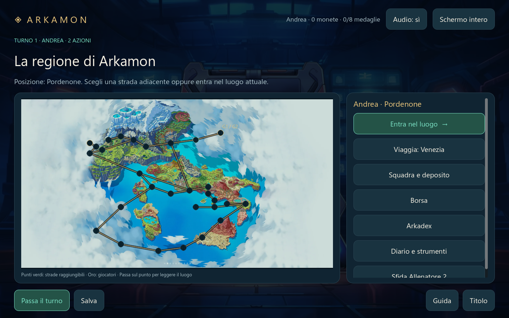

# Arkamon — Godot 0.2

La campagna 2D di **Arkamon per due giocatori sullo stesso PC**, realizzata in Godot 4.7.2 Standard. Parti da Pordenone, esplora la regione, allena e cattura i tuoi compagni, conquista le otto medaglie e affronta la Lega a Roma.

La versione 0.2 estende la prima demo con la campagna regionale e i suoi sistemi locali. Dati e materiali di riferimento vengono da [Arkamon Beta](https://github.com/Andreatz/Arkamon-Beta), al commit fissato `7ec91d1f4e3e5252317044b1ee300b8b3e4d80a7`. [PORTING.md](docs/PORTING.md) distingue le funzioni trasferite dalle parti della Beta che restano fuori da questa versione.



## Provarlo su Windows

Scarica **Arkamon-Godot-Windows.zip**, estrai tutti i file e apri **Arkamon.exe**. Il pacchetto è portatile: per giocare non servono Godot, Node.js, un browser o privilegi di amministratore.

Il workflow [Godot - verifica e build Windows](https://github.com/Andreatz/Arkamon-Godot/actions) prepara l'artefatto **Arkamon-Godot-Windows** nelle esecuzioni riuscite. L'esito di ogni build si trova nella sua pagina Actions.

## La campagna

- **Due allenatori locali**, con nomi, starter diversi fra Vyrath, Darklaw e Felyss, posizione, squadra, inventario e progressi personali. Il rivale riceve lo starter rimasto.
- **29 nodi della mappa regionale e 31 strade**, città e Percorsi 1–14, con **16 mappe locali originali**. Il Percorso 15 è il luogo segreto collegato a Roma e richiede tutte le otto medaglie; la sua mappa è inclusa nelle 16 mappe locali.
- **110 forme**, incontri selvatici del catalogo originale e **31 allenatori**, compresi il rivale e gli **otto capipalestra**.
- Battaglie a squadre, sostituzioni dopo un KO, iniziativa basata su livello e paralisi, mosse con D6, bonus, affinità, Suprema, stati alterati, cure e catture. È disponibile anche il **duello locale fra i due giocatori**.
- Squadra fino a **sei compagni**, con differenza massima di **cinque livelli**; deposito di **30 box da 35 posti**. Le catture fuori fascia o a squadra piena vanno nel deposito. Le evoluzioni seguono i livelli del catalogo.
- **ArkaStore e borsa** con Pozione, Superpozione, Rianimatore, Antidoto, Antiparalisi, Sveglia e Masterball. Un acquisto viene applicato interamente o rifiutato; un oggetto senza effetto non viene consumato.
- **Arkadex personale**, diario, archivio degli ultimi **20 scontri**, backup esportabile e ripresa della campagna, compresi gli scontri dall'ultimo turno concluso.
- **Lega configurabile**: quattro avversari consecutivi nello stesso turno e un eventuale Campione finale. Squadre, gestione della sconfitta e uso degli oggetti fra gli incontri si scelgono prima del tentativo. La vittoria finale richiede di vincere l'intera serie.
- **Editor nativo delle interazioni**: dialoghi, ricompense, cure, incontri e attività sui punti delle mappe locali, con requisiti e completamento personale o condiviso. Le configurazioni fanno parte del salvataggio.

## Come iniziare

1. Scegli **Nuova campagna**, i nomi e due starter diversi. I giocatori si alternano sullo stesso computer; non serve una connessione di rete.
2. Ogni turno ha **due azioni**: due movimenti oppure un movimento e un'interazione. Aprire la vista di un luogo è gratuito. Esplorare un cespuglio, sfidare un allenatore, curare la squadra o acquistare conclude le azioni disponibili. Premi **Passa il turno** quando hai finito.
3. Visita città e percorsi collegati. Allena i compagni negli incontri e nelle sfide disponibili, senza lasciare indietro i membri di livello più basso: al limite della fascia, l'EXP viene scartata e non accumulata. Puoi spostare i compagni tra squadra e deposito per preparare la formazione.
4. I **centri in città curano gratuitamente** tutta la squadra. Una sconfitta non termina la campagna: recupera le forze prima di ripartire. Il negozio usa le monete vinte contro gli allenatori.
5. Dopo le **otto medaglie**, raggiungi Roma, apri **La Lega di Arkamon** e configura i quattro avversari. Scegli se ripartire dal primo incontro o da quello raggiunto dopo una sconfitta, se usare oggetti fra gli incontri e se aggiungere il Campione. I PV residui passano da uno scontro al successivo.

Gli incontri e gli allenatori già completati sono registrati per ciascun giocatore. Le interazioni sui singoli punti non configurate nel riferimento originale restano vuote finché non vengono assegnate dall'editor; la versione Godot non inventa dialoghi o incontri del Percorso 15.

**Comandi:** mouse oppure **Tab/Invio**; in battaglia **1–3** per le mosse disponibili; **F11** per lo schermo intero, **M** per l'audio. Le impostazioni comprendono movimento ridotto e velocità delle animazioni normale, 2× o 3×. La modalità normale conserva i tempi originali.

## Sfide a seed e Fanta-Team

Dal titolo apri **Sfide a seed e Fanta-Team** per una partita separata dalla campagna. Le squadre hanno sei forme al livello 20, un budget di 100 crediti e nessuna specie ripetuta. La modalità a seed genera entrambe le squadre; Fanta-Team permette di scegliere la propria formazione. Sono disponibili regole aggiornate v2 e prezzi classici v1, codici JSON da copiare/importare e una classifica locale degli ultimi 30 risultati.

Seed, costi, squadre e identificatori sono compatibili con le regole della Beta. I tiri della battaglia usano il generatore di Godot: **i risultati dei combattimenti non sono confrontabili tra i due motori**. La classifica distingue seed, squadra, modalità e versione delle regole. I progressi della campagna non vengono usati o premiati dalla sfida separata.

## Grafica, animazioni e audio

Tutte le 110 forme hanno un ritratto. Le **37 forme animate presenti nella sorgente originale** dispongono di **185 clip** fra attesa, attacco, colpo, vittoria e KO: **17.754 fotogrammi originali a 24 FPS**, mantenuti in ordine. Le altre 73 forme usano ritratti statici con reazioni ed effetti Godot. Le trasformazioni dei materiali e i loro limiti sono descritti nella [provenienza](docs/ASSET_PROVENANCE.md).

Sono inclusi quattro effetti audio e otto effetti grafici generici per tipo di azione/tipo. Il gioco non include la libreria web completa dei 276 effetti curati per le singole mosse, né tutte le personalizzazioni SVG e dell'interfaccia React.

## Salvataggi e backup

La campagna salva in `user://full_campaign.json`, con file temporaneo e copia precedente di recupero. Nei combattimenti il punto di ripresa comprende squadre, PV, status, turno e stato del generatore casuale; la ripresa parte dall'ultimo turno salvato. I backup del **Diario e strumenti** comprendono entrambi i giocatori e la configurazione delle interazioni e della Lega.

Per compatibilità, la cartella Windows resta `%APPDATA%/Godot/app_userdata/Arkamon — Il primo viaggio/`. La prima demo Godot conserva `campaign.json`: dal titolo si può importarne squadra, pozioni e monete in una nuova campagna, previa conferma. Le sfere della prima demo non hanno un oggetto equivalente nel catalogo della campagna e non vengono convertite. La migrazione riparte da Pordenone e non assegna medaglie o una vittoria della Lega. **I salvataggi del browser non sono importati direttamente.**

Le sfide scrivono il proprio registro in `user://challenges.json`. La campagna e la classifica non richiedono account o server.

## Sviluppo e verifiche

Importa `project.godot` in **Godot 4.7.2 Standard**, senza .NET, poi premi **F5**. Il progetto usa il renderer **Compatibility**. Le schermate sono costruite da GDScript con nodi Control; non sono tutte scene indipendenti da impaginare nell'editor.

```powershell
$godot = & ./tools/fetch_godot.ps1
./tools/check.ps1 -Godot $godot

# Include esportazione Windows e avvio del pacchetto risultante.
$godot = & ./tools/fetch_godot.ps1 -WithTemplates
./tools/check.ps1 -Godot $godot -ExportWindows
```

[BUILD.md](docs/BUILD.md) contiene i comandi completi. [VERIFICATION.md](docs/VERIFICATION.md) riporta la batteria locale e i limiti della verifica; il risultato della CI si consulta separatamente in Actions. Le verifiche usano salvataggi dedicati.

## Materiali e attribuzioni

Vedi [ASSET_PROVENANCE.md](docs/ASSET_PROVENANCE.md) per fonti, trasformazioni e attribuzioni disponibili, e `data/import_manifest.json` per i checksum. Copiare i materiali del progetto originale non attribuisce nuove licenze ai contenuti. Il credito originale del suono di cura resta in `assets/audio/CreditToZachry.txt` e nel pacchetto Windows.

Il porting include il gioco locale e i suoi strumenti nativi. Votazioni del pubblico con QR e backend, strumenti di regia React e personalizzazione visuale completa della UI web non sono trasferiti in questa versione.
