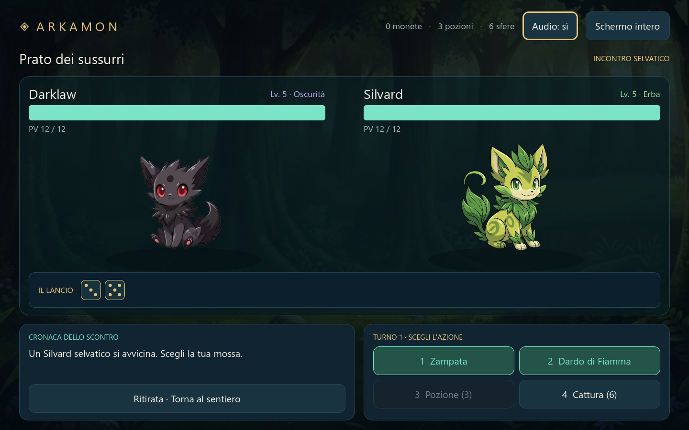

# Arkamon — Il primo viaggio

Prima versione giocabile **2D per PC in Godot 4.7.2**, costruita per provare il passaggio di Arkamon a un motore dedicato. È un'avventura breve e autonoma: un laboratorio, un sentiero, tre incontri e una conclusione.



## Provarlo su Windows

Scarica il pacchetto Windows, estrai tutto lo ZIP e avvia **Arkamon.exe**. Non occorre installare Godot, Node.js o un browser. Il pacchetto è portatile e non richiede privilegi di amministratore.

Le build automatiche sono disponibili come **Arkamon-Godot-Windows** negli **Artifacts** delle esecuzioni riuscite di [Godot - verifica e build Windows](https://github.com/Andreatz/Arkamon-Godot/actions). Per sviluppare, importa invece `project.godot` in Godot **4.7.2 Standard** e premi **F6/F5** per avviare la scena/progetto.

## Cosa puoi giocare

- Scelta fra **Vyrath, Darklaw e Felyss**, con le loro animazioni originali di attesa: 96 fotogrammi a 24 FPS per compagno.
- Un percorso di cinque punti: laboratorio, prato, sorgente, bosco e radura finale. Gli incontri comprendono Silvard o Felvex, Blazion e Deephion.
- Combattimenti con iniziativa D6, due mosse per creatura, dadi visibili, affinità tra tipi, reazione ai colpi e barre PV animate.
- Pozioni, cattura con tre D6, squadra fino a sei compagni e scelta del compagno da schierare prima dello scontro.
- Un livello e 15 monete per vittoria o cattura. Laboratorio e sorgente ripristinano gratuitamente tutta la squadra.
- Salvataggio locale automatico dopo incontri e riposi, ripresa dal titolo e copia precedente di recupero.
- Audio degli effetti, schermo intero e opzione per ridurre i movimenti.

**Comandi:** mouse oppure Tab/Invio; in battaglia **1–2** per le mosse, **3** per la pozione, **4** per la cattura. **F11** per lo schermo intero, **M** per l'audio.

Se il compagno viene sconfitto, torna al laboratorio o alla sorgente per curare la squadra. Puoi ritirarti da uno scontro conservando i PV e gli oggetti già usati.

## Confini di questa versione

Questa è una prima porzione giocabile, **non il porting completo di Arkamon Beta**. Il percorso e le sue tappe sono costruiti per questa prova. Non comprende PvP, campagna completa, tutte le mappe, evoluzioni, negozio, deposito, stati alterati o salvataggi condivisi con la versione web. Le monete sono un premio registrato: in questa prova non c'è un negozio. Le pozioni e le sfere iniziali sono limitate, mentre la cura ai punti di riposo è gratuita.

Il catalogo di 110 creature e i dati delle mosse sono importati integralmente; nella prova sono utilizzabili sette specie, con grafica dedicata. Le animazioni originali importate riguardano l'attesa dei tre starter. Gli attacchi e i colpi usano movimenti ed effetti creati in Godot; le altre creature usano ritratti statici.

La logica è scritta in **GDScript**, con regole di battaglia e salvataggio indipendenti dall'interfaccia. I dati JSON e i materiali vengono dal commit fissato `7ec91d1f4e3e5252317044b1ee300b8b3e4d80a7` di [Arkamon Beta](https://github.com/Andreatz/Arkamon-Beta). La formula del danno e la cattura riprendono il riferimento originale; progressione del percorso, premi, inventario iniziale e iniziativa sono semplificati per questa prova.

## Sviluppo e verifiche

Apri il progetto nella versione Standard di Godot, senza .NET o estensioni esterne. Il rendering **Compatibility** usa OpenGL per mantenere semplici i requisiti di questa versione 2D.

```powershell
# Scarica l'editor ufficiale e controlla il checksum.
./tools/fetch_godot.ps1

# Importa risorse ed esegue le verifiche.
./tools/check.ps1

# Esegue anche l'esportazione Windows e avvia il pacchetto esportato.
./tools/check.ps1 -ExportWindows
```

I dettagli su editor, export e artefatti CI sono in [BUILD.md](docs/BUILD.md). I test dei salvataggi usano percorsi dedicati e non sovrascrivono il viaggio del giocatore.

Il gioco salva in `user://campaign.json`, con `.bak` e `.tmp` per recuperare una scrittura interrotta. Su Windows, nella configurazione standard di Godot, la cartella si trova sotto `%APPDATA%/Godot/app_userdata/Arkamon — Il primo viaggio/`. La cartella resta separata dai salvataggi di Arkamon Beta. Durante una battaglia il salvataggio automatico rappresenta l'ultimo incontro terminato: la ripresa non ricostruisce un turno interrotto.

## Materiali e attribuzioni

Vedi [provenienza dei materiali](docs/ASSET_PROVENANCE.md) per URL originali, trasformazioni e attribuzioni disponibili, e `data/import_manifest.json` per i checksum. La copia dei materiali del progetto originale non attribuisce nuove licenze ai contenuti. Il credito originale disponibile per il suono di cura è conservato in `assets/audio/CreditToZachry.txt` e nei pacchetti Windows.

Per riprodurre l'importazione: Python con Pillow e `python tools/import_beta_assets.py`. Non serve Python per giocare o modificare il progetto in Godot.
